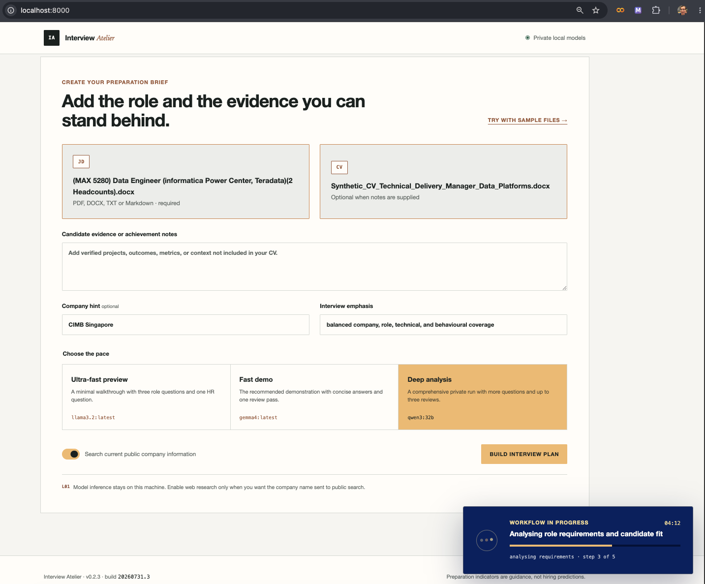
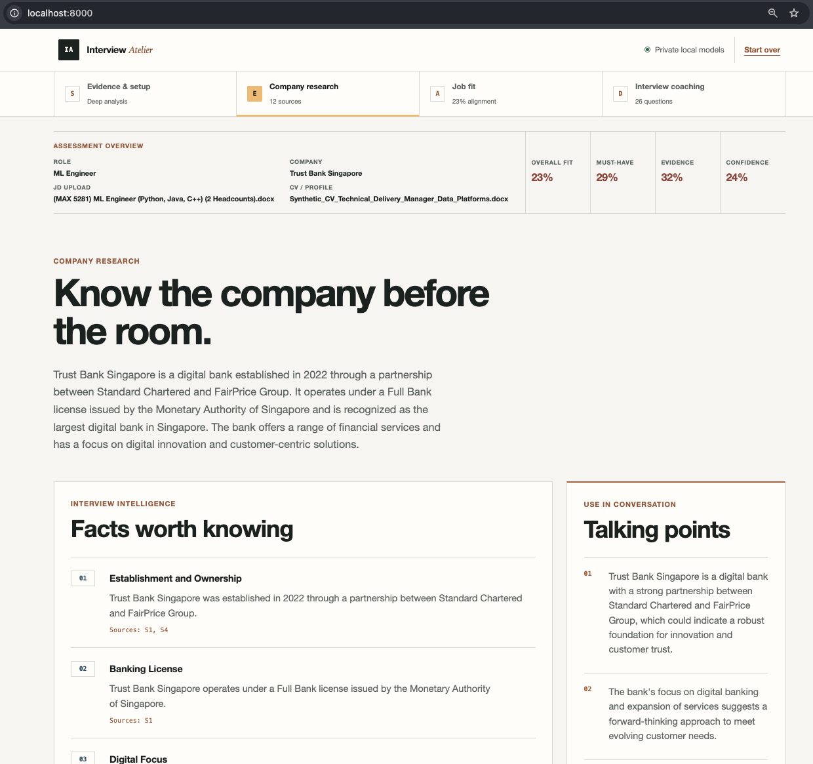
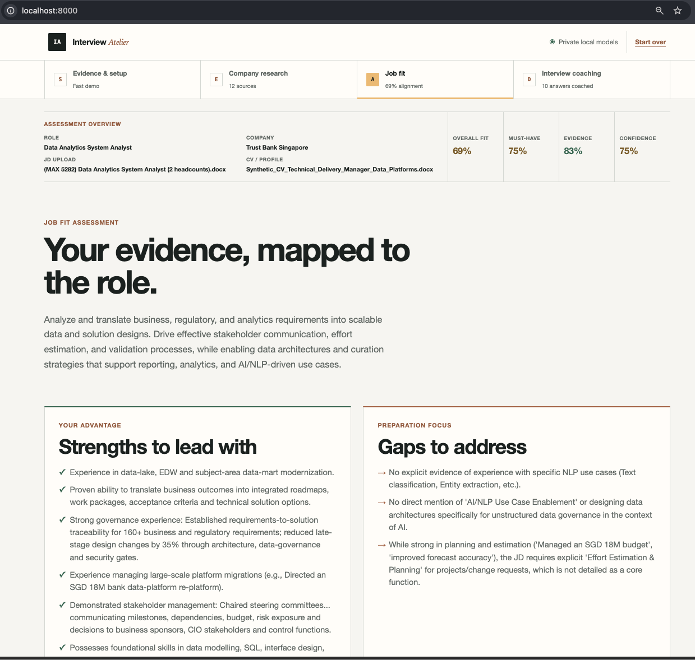
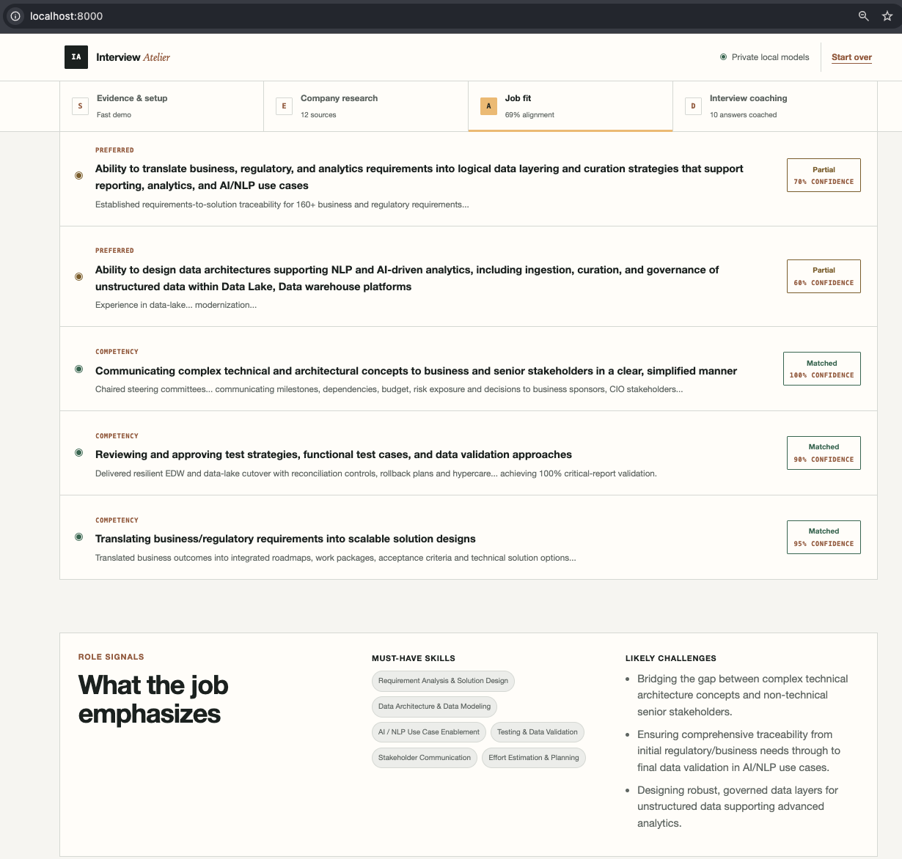
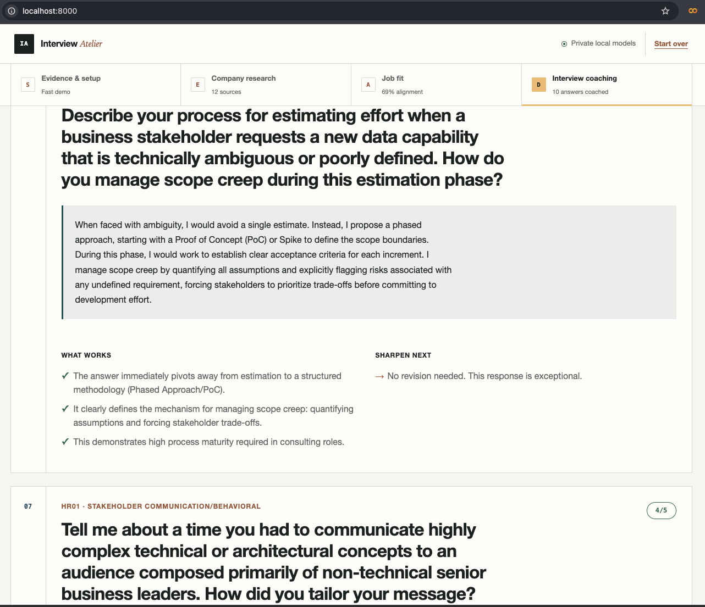
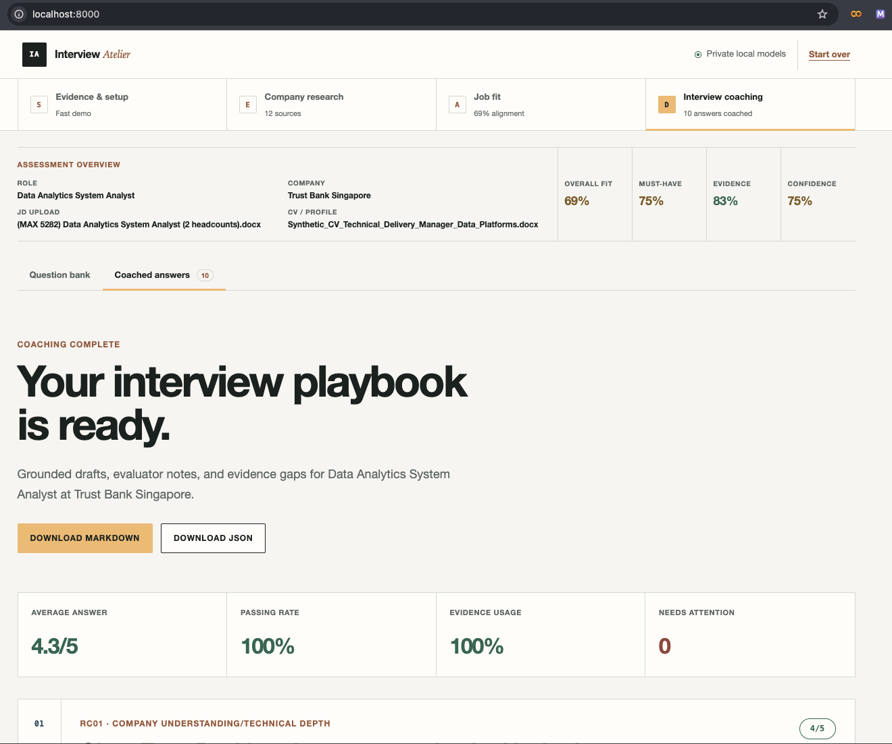
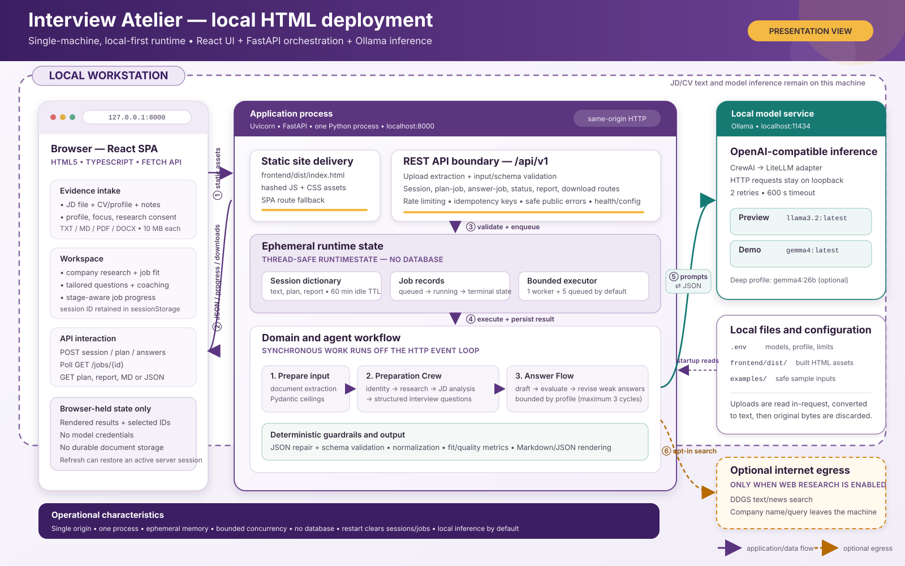

# Interview Atelier

Interview Atelier is a locally hosted, multi-agent agentic application that helps candidates prepare for their job interview, by using LLM to analyse the uploaded JD & CV and summarise job-fit strength and gaps. Coaching is provided on simulated question and answers on the job requirements, company and HR-type questions to surface strong answers. 

### Local inference, not shared to internet
Job-fit analysis, and interview Q&A coaching is achieved using the locally downloaded LLM models, without sending information to the internet. 

### Search Company Information shares info to internet
Research Company feature is an optional selection which summarises relevant company information against the JD. Usage of this feature requires information on the company and job characteristics to be shared over internet.

Technical implementation combines a React/HTML interface (Single Page Application), FastAPI orchestration, CrewAI agents, and local Ollama models (configurable choice of LLM models).



## What the application does

Provide a job description and candidate evidence such as a CV, résumé, career profile,
or achievement notes. The application:

- researches the company, with optional public web retrieval and source links;
- analyses the role, seniority, responsibilities, skills, and interview themes;
- compares job requirements with evidence in the candidate documents;
- reports job-fit indicators, strengths, gaps, and preparation priorities;
- generates role, company, HR, and behavioural questions;
- drafts answers grounded in candidate-supplied evidence; and
- evaluates and revises weak answers within a hard three-cycle maximum.

Specialist CrewAI agents handle company identity, research, job analysis, interview
design, answering, and evaluation. Pydantic schemas and deterministic normalisation
enforce structured outputs and workflow limits around the local model.

### Company Research & Job Fit summary metrics



### Job-fit analysis





### Coaching Interview Question & Answers



### Download Report



[sample report](assets/downloads/interview-report_qwen3.32b_CIMB.md)

## Local architecture



The browser loads the compiled React application from FastAPI on
`http://127.0.0.1:8000`. FastAPI validates uploads, owns ephemeral sessions and jobs,
and runs synchronous CrewAI workflows in a bounded worker thread. Model requests use
Ollama over loopback at `http://127.0.0.1:11434`.

See the [local HTML deployment architecture](docs/12-local-html-deployment-architecture.md)
for the full component, data-flow, privacy, and failure model.

## Local requirements

### Hardware

The application does not require a dedicated GPU. Ollama uses Apple Metal on Apple
Silicon and supported GPUs on other platforms; CPU-only inference is possible but
slower.

| Profile | Default model | Approximate model download | Practical memory |
|---|---|---:|---:|
| Preview | `llama3.2:latest` | about 2 GB | 8 GB minimum |
| Demo | `gemma4:latest` | about 9.6 GB | 16 GB minimum; 24 GB recommended |
| Deep | `gemma4:26b` | about 17 GB | 32 GB minimum; 48 GB recommended |

Model package sizes can change with future tags. Allow additional storage for the
source tree, Python environment, Node packages, and frontend build.

### Software

| Requirement | Supported or recommended version |
|---|---|
| Operating system | macOS, Linux, or Windows through WSL2 |
| Python | 3.10 through 3.13 |
| Node.js | 20.19+ or 22.12+ |
| npm | Version bundled with a supported Node.js release |
| Ollama | Current release, with its local service running |
| Browser | Current Chrome, Edge, Firefox, or Safari |

Internet access is needed for initial dependency and model downloads. Company research
also needs internet access. With web research disabled, runtime evidence and inference
remain on the workstation.

### Project Documentation 
| Filename | Description |
| --- | --- |
| [README.md](docs/README.md) | Recommended reading order |
| [DESIGN.md](./DESIGN.md) | Personalised style guide (for GenAI) to create consistent visual content across interfaces, documents, and presentations. | 
| [00-project-brief.md](docs/00-project-brief.md) | Purpose, user, principles, scope, and success criteria. |
| [01-product-requirements.md](docs/01-product-requirements.md) | Journeys, functional requirements, local profiles, non-functional requirements, and acceptance criteria. |
| [02-system-architecture.md](docs/02-system-architecture.md) | Runtime components, flows, trust boundaries, failure behaviour, and scalability boundary.|
| [03-llm-and-agent-design.md](docs/03-llm-and-agent-design.md) | Ollama profiles, agents, evaluator–optimizer Flow, structured output, and evidence controls. |
| [04-ux-design.md](docs/04-ux-design.md) | Information architecture, screens, responsive behaviour, states, accessibility, and content. |
| [05-api-and-data-design.md](docs/05-api-and-data-design.md) | FastAPI routes, job lifecycle, validation, and contracts. |
| [06-deployment-and-operations.md](docs/06-deployment-and-operations.md) | Scope: local deployment. Installation, build, startup, configuration, health, capacity, logging, and recovery. Removed Docker, Hugging Face Spaces, secrets, observability, and costs. |
| [07-security-and-privacy.md](docs/07-security-and-privacy.md) | Data lifecycle, threats, controls, local binding, logging, and disclosures. |
| [08-testing-and-quality.md](docs/08-testing-and-quality.md) | Deterministic automation, local model checks, static gates, and smoke tests. | 
| [09-implementation-plan.md](docs/09-implementation-plan.md) | Completed baseline, maintenance workstreams, backlog, sequence, and definition of done. |
| [10-decision-log.md](docs/10-decision-log.md) | Active architectural decisions. |
| [11-dependencies-and-releases.md](docs/11-dependencies-and-releases.md) | Dependencies and releases. |
| [12-local-html-deployment-architecture.md](docs/12-local-html-deployment-architecture.md) | Detailed topology and operational walkthrough. | 
| [13-model-compatibility.md](docs/13-model-compatibility.md) | LLM model compatibility. |


## Run locally

### 1. Install the application

```bash
git clone https://github.com/johnphs-9/multiagent-job-local.git
cd multiagent-job-local
python3 -m venv .venv
source .venv/bin/activate
python -m pip install --upgrade pip
python -m pip install -e ".[dev]"
npm install --prefix frontend
cp .env.example .env
```

### 2. Start Ollama

The Ollama desktop application may already provide the local service. Otherwise:

```bash
ollama serve
```

Confirm installed models:

```bash
ollama list
```

Pull the model required for the selected profile (if not already installed previously):

```bash
ollama pull llama3.2:latest
ollama pull gemma4:latest
ollama pull gemma4:26b
```

Only the Preview model is required for the quickest first run.

### 3. Build the HTML application

```bash
npm run build --prefix frontend
```

Rebuild after changing frontend source files.

### 4. Start FastAPI

The recommended convenience launcher checks the operating system, Python environment,
Python imports, Node/npm versions, frontend packages and build, profile configuration,
Ollama process, every model required by the enabled runtime profiles, and local ports
before starting:

```bash
./scripts/start-local.sh
```

Every check is printed as `[x]` when satisfied or `[ ]` with corrective guidance when
it fails. Each missing Ollama model includes its exact `ollama pull` command; models
are not downloaded automatically. If Ollama is not running, the launcher starts it.
Uvicorn runs in the foreground so its server and access logs remain visible in the
terminal. `Ctrl+C` stops Uvicorn and any Ollama process started by the launcher,
without stopping a pre-existing Ollama process.

Check the environment without starting or building anything:

```bash
./scripts/start-local.sh --check-only
```

Equivalent Make targets are:

```bash
make start
make doctor
```

The direct server command remains available:

```bash
source .venv/bin/activate
python -m uvicorn job_interviewer.api.app:app --host 127.0.0.1 --port 8000
```

Open <http://127.0.0.1:8000>. Select **Try with sample files** and the Preview
profile for the shortest test. Press `Ctrl+C` to stop the server.

`make run` executes only this direct Uvicorn command and skips prerequisite checks.

### Frontend development mode

Run the API and Vite servers in separate terminals:

```bash
source .venv/bin/activate
python -m uvicorn job_interviewer.api.app:app --reload --port 8000
```

```bash
npm run dev --prefix frontend
```

Open <http://127.0.0.1:5173>. Vite proxies `/api` to FastAPI.

### Health checks

```bash
curl http://127.0.0.1:8000/api/v1/health/live
curl http://127.0.0.1:8000/api/v1/health/ready
```

Readiness checks that Ollama is reachable and the selected model is installed.

## Agentic workflow

```text
JD + candidate evidence
        |
        v
Identity analyst -> optional cited public web retrieval
        |
        v
Company research analyst + JD analyst
        |
        v
Interview architect -> typed, capped question set
        |
        v
Answer coach -> evaluator -> targeted revision
                  ^              |
                  +--------------+
                    maximum 3 cycles
```

CrewAI Crews coordinate the preparation specialists. A typed CrewAI Flow owns the
evaluator–optimizer loop. Pydantic schemas, evidence ledgers, JSON repair, and
deterministic metrics constrain model output.

## Runtime profiles

Profile limits are enforced by the backend.

| Profile | Questions | Answers coached | Reviews | Local model |
|---|---:|---:|---:|---|
| Preview | 3 role + 1 HR | up to 3 | 1 | `llama3.2:latest` |
| Demo | 6 role + 2 HR | up to 6 | 1 | `gemma4:latest` |
| Deep | 20 role + 6 HR | up to 26 | 3 | `gemma4:26b` |

## Configuration

Copy [.env.example](.env.example) and adjust it locally:

```dotenv
DEFAULT_MODEL_PROFILE=demo
OLLAMA_BASE_URL=http://localhost:11434
OLLAMA_PREVIEW_MODEL=llama3.2:latest
OLLAMA_DEMO_MODEL=gemma4:latest
OLLAMA_DEEP_MODEL=gemma4:26b
OLLAMA_REASONING_EFFORT=none

PROFILE_DEMO_ROLE_QUESTION_COUNT=6
PROFILE_DEMO_HR_QUESTION_COUNT=2
PROFILE_DEMO_ANSWER_SELECTION_DEFAULT=4
PROFILE_DEMO_ANSWER_SELECTION_MAXIMUM=6
PROFILE_DEMO_MAX_ITERATIONS=1
PROFILE_DEMO_PASS_SCORE=4
PROFILE_DEMO_ANSWER_WORD_LIMIT=120
PROFILE_DEMO_MAX_TOKENS=4096
PROFILE_DEMO_SEARCH_REGION=sg-en

ENABLE_DEEP_PROFILE=true
SESSION_IDLE_MINUTES=60
MAX_SESSIONS=50
JOB_WORKER_CONCURRENCY=1
JOB_QUEUE_SIZE=5
REQUEST_LIMIT_PER_HOUR=20
```

`OLLAMA_REASONING_EFFORT=none` preserves the completion budget for structured JSON.
Advanced users can try `low`, with increased latency and structured-output risk.
The complete Preview, Demo, and Deep profile definitions—including labels,
descriptions, limits, pass scores, token ceilings, and search regions—are listed in
[`.env.example`](.env.example) using the `PROFILE_PREVIEW_*`, `PROFILE_DEMO_*`, and
`PROFILE_DEEP_*` prefixes. Invalid or internally inconsistent profile values stop
application startup with a configuration error.

## Privacy and limits

- Model inference runs through Ollama on the workstation.
- Optional web research sends the inferred company name and search terms to public
  search.
- Sessions exist in process memory and expire after 60 idle minutes by default.
- Original upload bytes are discarded after extraction.
- Files are limited to 10 MB and extracted text to 60,000 characters.
- Candidate facts must originate from candidate evidence.
- Fit and quality scores are preparation indicators, not hiring probabilities.

## Command-line interface

```bash
job-interviewer \
  --jd-file examples/job_description.txt \
  --candidate-file examples/candidate_profile.txt \
  --offline \
  --plan-only
```

## Quality checks

```bash
source .venv/bin/activate
pytest
ruff check .
npm test --prefix frontend -- --run
npm run build --prefix frontend
```

Automated tests mock agent operations and do not call Ollama or public search.

## Project structure

```text
.
├── assets/                       # Architecture diagram and public screenshots
├── docs/                         # Local-only product and engineering documentation
├── examples/                     # Safe sample inputs
├── frontend/                     # React + TypeScript + Vite
├── src/job_interviewer/
│   ├── api/                      # FastAPI routes and ephemeral job runtime
│   ├── answer_flow.py            # Bounded evaluator–optimizer Flow
│   ├── config.py                 # Ollama models and profile policy
│   ├── crew.py                   # Preparation specialist Crew
│   ├── llm.py                    # Local Ollama LLM construction
│   ├── schemas.py                # Typed contracts and hard limits
│   └── service.py                # Shared application services
├── tests/                        # Deterministic backend tests
├── Makefile                      # Local commands
└── pyproject.toml                # Python package and dependencies
```
