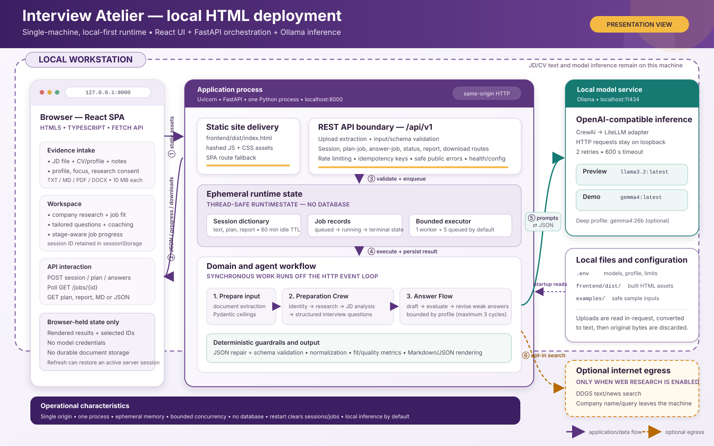

# System Architecture

**Status:** Implemented baseline
**Scope:** Single-workstation React, FastAPI, CrewAI, and Ollama runtime
**Last updated:** 2026-07-31

## 1. Architectural objective

Provide a browser-native interview preparation workspace while keeping application
state, candidate evidence, orchestration, and model inference on one workstation.



The detailed operational view is in
[Local HTML deployment architecture](12-local-html-deployment-architecture.md).

## 2. Runtime context

```text
Browser
  |
  | loopback HTTP: HTML, assets, JSON, uploads, progress, downloads
  v
Uvicorn + FastAPI
  +--------------------------------------------------------------+
  | React static delivery and SPA fallback                       |
  | REST API validation, sessions, jobs, health, report export   |
  | Thread-safe RuntimeState + bounded ThreadPoolExecutor         |
  | Domain services, CrewAI agents, schemas, metrics, rendering   |
  +--------------------------+-----------------------------------+
                             |
                             | loopback model requests
                             v
                           Ollama

Optional company-name queries -> public DDGS search
```

## 3. Component responsibilities

### React frontend

- Collect evidence, company hint, focus, profile, and research consent.
- Create and reconnect to an ephemeral session.
- Submit plan and answer jobs with idempotency keys.
- Poll job state and render stage-based progress.
- Display research, fit analysis, questions, coaching, and metrics.
- Download Markdown and JSON reports.
- Keep only the session ID in browser `sessionStorage`.

### FastAPI application

- Serve `frontend/dist` and the SPA route fallback.
- Validate multipart uploads, JSON bodies, and server-owned profile limits.
- Own session and job lifecycle.
- Apply rate limits and idempotency.
- Execute synchronous domain services outside the event loop.
- Convert failures into safe public errors.
- Expose liveness, readiness, configuration, result, and download routes.

### RuntimeState

`RuntimeState` owns ephemeral state under a re-entrant lock:

- session dictionary with extracted text, plan, and report;
- job dictionary with state, stage, message, and timestamps;
- idempotency index;
- idle cleanup;
- one active job per session;
- bounded submission slots; and
- a `ThreadPoolExecutor` for workflow execution.

The default is one running workflow and five queued workflows. Starting multiple
Uvicorn workers is unsupported because each process would have an isolated state store.

### Domain services

| Module | Responsibility |
|---|---|
| `documents.py` | Safe document extraction and limits |
| `schemas.py` | Typed contracts and hard ceilings |
| `research.py` | Optional deterministic public evidence retrieval |
| `crew.py` | Identity, research, JD, and question specialists |
| `answer_flow.py` | Draft/evaluate/revise loop |
| `metrics.py` | Deterministic aggregate metrics |
| `render.py` | Markdown rendering |
| `service.py` | Application use cases |

### Ollama adapter

`Settings` resolves the selected local model and output ceiling. `create_llm()` creates
a CrewAI/LiteLLM client with:

- an `ollama/`-qualified model name;
- the loopback Ollama base URL;
- finite timeout and retry limits;
- a profile-owned token ceiling; and
- hidden reasoning disabled by default.

Agents do not construct HTTP clients or select model tags themselves.

## 4. Main data flows

### Startup

```text
Import application
 -> load .env
 -> validate profile and reasoning settings
 -> create RuntimeState and rate limiter
 -> locate frontend/dist
 -> expose liveness
 -> readiness checks Ollama and selected model
```

### Plan generation

```text
Browser uploads evidence
 -> API validates and extracts text
 -> original bytes fall out of scope
 -> RuntimeState creates session
 -> API enqueues plan job and returns 202
 -> worker checks Ollama
 -> identity analysis
 -> optional public company retrieval
 -> research + JD analysis + question design
 -> schema validation and deterministic normalisation
 -> metrics calculation
 -> InterviewPackage stored in session
 -> browser polls completion and fetches plan
```

### Answer generation

```text
Browser submits selected question IDs
 -> API validates IDs and profile ceiling
 -> worker checks Ollama
 -> answer agent drafts from evidence ledger
 -> evaluator scores and flags unsupported claims
 -> weak answers are revised within the hard cycle limit
 -> metrics calculation
 -> InterviewReport stored in session
 -> browser fetches report and downloads
```

## 5. Trust boundaries

| Boundary | Data | Control |
|---|---|---|
| Browser to FastAPI | Uploads, notes, selections | Loopback binding, size limits, schema validation |
| FastAPI to Ollama | Extracted evidence and workflow prompts | Loopback endpoint |
| Domain to public search | Company name and search terms | Explicit user toggle |
| FastAPI to browser | Safe structured results and errors | Response models and error mapping |

JD, CV, notes, plan, and report remain in process memory. Public search results are
treated as untrusted evidence and supplied to the research agent with explicit
instruction-isolation rules.

## 6. Failure model

| Failure | Behaviour |
|---|---|
| Invalid document | Immediate `422`; no job created |
| Ollama unavailable | Readiness or job fails with recovery guidance |
| Model not installed | Preflight names the missing model |
| Queue full | Retryable `503`; work is not accepted |
| Active session job | `409`; existing work continues |
| Invalid model structure | Local JSON repair and one correction request |
| Search unavailable | Continue with JD-only research and record a limitation |
| Session expired | Expired/not-found response and restart guidance |
| Process restart | All ephemeral sessions and jobs are lost |

## 7. Scalability boundary

The system is deliberately optimised for one user workstation:

- one API process;
- one workflow worker by default;
- ephemeral state;
- local model capacity;
- no authentication; and
- no shared persistence.

Adding multiple processes or remote clients would require a shared session store,
durable work queue, authentication, distributed rate limits, and a revised privacy
model. Those capabilities are outside this architecture.
