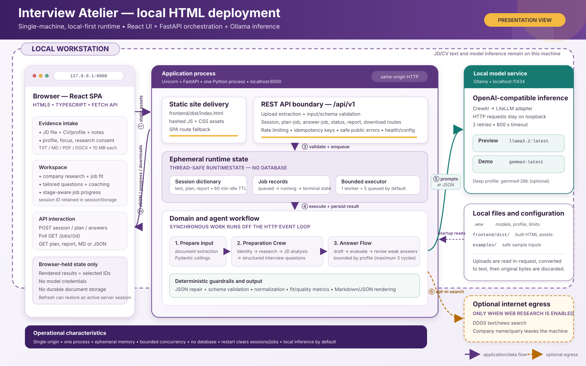

# Local HTML Deployment Architecture

**Status:** Implemented  
**Scope:** Local React/HTML interface with FastAPI, CrewAI, and Ollama  
**Last updated:** 2026-07-31

This document describes the recommended local deployment of Interview Atelier. It is
deliberately limited to the browser-based HTML application running on one workstation.



The diagram is a presentation-ready SVG. It can be opened directly in a browser or
placed on a slide without rasterisation.

## 1. Architecture summary

The local deployment is a single-machine, local-first system:

1. A React single-page application runs in the user's browser.
2. Uvicorn hosts one FastAPI process on `127.0.0.1:8000`.
3. FastAPI serves the compiled files in `frontend/dist` and exposes `/api/v1`.
4. Long-running workflows execute in a bounded thread pool so they do not block the
   HTTP event loop.
5. CrewAI coordinates the preparation agents and the answer-improvement flow.
6. The Ollama LLM adapter calls the local service over loopback at
   `http://localhost:11434`.
7. Sessions, jobs, plans, and reports exist only in process memory.

There is no database, durable queue, or separate application server. The original
upload bytes are discarded after text extraction. Only optional company web research
crosses the workstation boundary.

## 2. Local process topology

| Component | Process or location | Default address | Responsibility |
|---|---|---|---|
| React SPA | Browser tab | `http://127.0.0.1:8000` | Evidence intake, workflow controls, progress, results, downloads |
| Uvicorn | Python process | `127.0.0.1:8000` | ASGI server and connection handling |
| FastAPI | Same Python process | `/api/v1` | Static delivery, validation, sessions, jobs, reports, health |
| `RuntimeState` | Same Python process | In-memory only | Thread-safe session/job records and bounded executor |
| CrewAI domain services | Executor worker thread | In-process | Research, fit analysis, question design, answer coaching |
| Ollama | Local service process | `127.0.0.1:11434` | Model loading and inference |
| DDGS search | External, optional | HTTPS | Company text/news retrieval when the user opts in |

The browser and API use the same origin in the recommended local runtime. This removes
the need for CORS configuration and lets FastAPI provide the SPA route fallback.

## 3. Build-time and start-up view

### Build the HTML application

```bash
npm run build --prefix frontend
```

Vite and TypeScript compile the React application into `frontend/dist`. The directory
contains `index.html` and content-hashed JavaScript/CSS assets. It is a build artifact
and must be rebuilt after frontend source changes.

### Start the local services

Ollama must be available with the model required by the selected profile:

```bash
ollama serve
ollama pull llama3.2:latest
```

Then start the HTML application from the repository root:

```bash
source .venv/bin/activate
python -m uvicorn interview_local.api.app:app --host 127.0.0.1 --port 8000
```

At application import, `Settings.from_env()` loads `.env`, builds and validates all
profile definitions, selects the Ollama endpoint, and constructs `RuntimeState`.
FastAPI mounts `frontend/dist/assets` at `/assets` and returns `index.html` for non-API
browser routes.

## 4. Browser and HTTP boundary

The React application never receives model credentials or direct Ollama access. It
uses the following API lifecycle:

| Phase | Request | Server behaviour |
|---|---|---|
| Bootstrap | `GET /api/v1/config` | Returns enabled profiles, model labels, limits, version, and upload rules |
| Evidence | `POST /api/v1/sessions` | Validates and extracts uploads, then creates an ephemeral session |
| Plan | `POST /api/v1/sessions/{id}/plan-jobs` | Applies server-owned profile limits and returns `202 Accepted` |
| Progress | `GET /api/v1/jobs/{job_id}` | Returns job state, stage, message, and coarse completed steps |
| Plan result | `GET /api/v1/sessions/{id}/plan` | Returns research, fit analysis, metrics, and questions |
| Coaching | `POST /api/v1/sessions/{id}/answer-jobs` | Validates selected question IDs and enqueues answer work |
| Report | `GET /api/v1/sessions/{id}/report` | Returns evaluated and revised answers |
| Export | `GET /api/v1/sessions/{id}/downloads/report.{md,json}` | Renders a local download without storing a file |

The browser polls queued or running jobs after one second initially, then backs off to
2.2 seconds after ten polls. A random idempotency key prevents duplicate plan or answer
submissions. The session ID is retained in browser `sessionStorage` so a refresh can
reconnect while the in-memory server session remains valid.

## 5. Input and data lifecycle

```text
Upload bytes
  -> 10 MB request limit and extension check
  -> TXT/Markdown, PDF, or DOCX text extraction
  -> text cleaning and 60,000-character ceiling
  -> original bytes discarded
  -> extracted JD/CV text stored in RuntimeState
  -> plan and report objects added to the same session
  -> session deleted explicitly, after idle expiry, or on process exit
```

The default runtime allows 50 sessions and expires an inactive session after 60
minutes. A process restart clears every session, job, plan, and report. Report downloads
are generated from the in-memory Pydantic object and are not written to disk.

## 6. Asynchronous job execution

The API returns quickly from plan and answer submissions. `RuntimeState` supplies the
long-running execution boundary:

- one `ThreadPoolExecutor` worker by default;
- five additional queued jobs by default;
- at most one active job per session;
- a non-blocking bounded semaphore for immediate queue-capacity enforcement;
- idempotency indexed by session, job type, and idempotency key;
- job states `queued`, `running`, `succeeded`, `failed`, or `cancelled`;
- thread-safe progress and result updates under a re-entrant lock.

CrewAI operations are synchronous, but they run in the executor thread rather than the
FastAPI event-loop thread. Queue exhaustion produces a retryable `503`; a second active
job for one session produces `409`.

This architecture is intentionally single-process. Starting multiple Uvicorn workers
would create isolated session dictionaries and queues, so the supported local command
uses one worker.

## 7. Agent and model execution

### Plan job

```text
Validate inputs
  -> identify company and role
  -> optionally retrieve public company evidence
  -> synthesise company research
  -> analyse JD and candidate fit
  -> design role/company and HR questions
  -> validate and normalise structured results
  -> calculate fit and question-quality metrics
  -> store InterviewPackage in the session
```

The preparation workflow uses four specialist roles: identity analyst, company
research analyst, job-description analyst, and interview architect. The final three
tasks run sequentially in a CrewAI Crew after identity resolution.

### Answer job

```text
Select validated question IDs
  -> draft evidence-grounded answers
  -> evaluate every pending answer
  -> revise only answers below the pass score
  -> repeat within the selected profile's hard iteration ceiling
  -> calculate answer-quality metrics
  -> store InterviewReport in the session
```

The typed CrewAI Flow owns the bounded evaluator–optimizer loop. Pydantic schemas,
evidence-ID filtering, JSON repair, one model correction attempt, normalisation, and
deterministic metrics guard the output around the probabilistic model.

### Ollama boundary

`create_llm()` constructs one CrewAI/LiteLLM client using an Ollama-qualified
model name and the local base URL. Requests travel over loopback and include:

- the selected model for Preview, Demo, or Deep;
- a profile-owned output-token ceiling;
- a 600-second default timeout;
- at most two transport retries;
- `reasoning_effort=none` by default to preserve the structured-output budget.

The API checks `/api/tags` before work begins to confirm that Ollama is reachable and
that the selected model is installed.

## 8. Privacy and trust boundaries

| Boundary | Data crossing it | Control |
|---|---|---|
| Browser → FastAPI | JD/CV bytes, notes, preferences | Loopback HTTP, document limits, schema validation |
| FastAPI → Ollama | Prompts containing extracted evidence | Loopback HTTP; local inference |
| Domain → DDGS search | Inferred company name and search terms | Disabled unless the user enables web research |
| FastAPI → Browser | Structured plan/report and progress | Safe API models and public error messages |

With web research disabled, the complete inference path remains on the workstation
after dependencies and model files are installed. Operational logs should not include
document text, prompt bodies, raw model completions, or secrets.

## 9. Failure and recovery behaviour

| Failure | Local behaviour | Recovery |
|---|---|---|
| Frontend build absent | FastAPI returns `503` for the UI | Run the frontend build command and restart/refresh |
| Ollama unavailable | Readiness or the job fails safely | Start Ollama and retry |
| Selected model absent | Preflight identifies the missing model | Pull the model and retry |
| Queue full | New job receives retryable `503` | Wait for the active job to finish |
| Invalid structured output | Local JSON repair, then one correction call | Retry with a stronger local model if correction fails |
| Optional search unavailable | Workflow continues with JD-only research | Disable research or retry later |
| Session expired | API returns expired/not-found guidance | Start a new session |
| Python process restarts | All ephemeral state is lost | Re-upload inputs and rerun |

## 10. Local verification

After starting Ollama and Uvicorn:

```bash
curl http://127.0.0.1:8000/api/v1/health/live
curl http://127.0.0.1:8000/api/v1/health/ready
```

Then open <http://127.0.0.1:8000>, use the sample files with the Preview profile, and
verify:

- the application and static assets load from port 8000;
- plan and answer submissions return immediately and expose progress;
- plan and report results survive a browser refresh within the session lifetime;
- Markdown and JSON downloads contain the final report;
- disabling web research produces a fully local run;
- restarting Uvicorn clears the previous session as designed.

## 11. Key implementation references

| Concern | Implementation |
|---|---|
| FastAPI routes and static delivery | `src/interview_local/api/app.py` |
| Session/job runtime | `src/interview_local/api/runtime.py` |
| Profiles and environment contract | `src/interview_local/config.py` |
| Ollama model adapter | `src/interview_local/llm.py` |
| Application use cases | `src/interview_local/service.py` |
| Preparation agents | `src/interview_local/crew.py` |
| Answer evaluator–optimizer flow | `src/interview_local/answer_flow.py` |
| Browser API client and polling | `frontend/src/api.ts` |
| Frontend production build | `frontend/vite.config.ts` |
